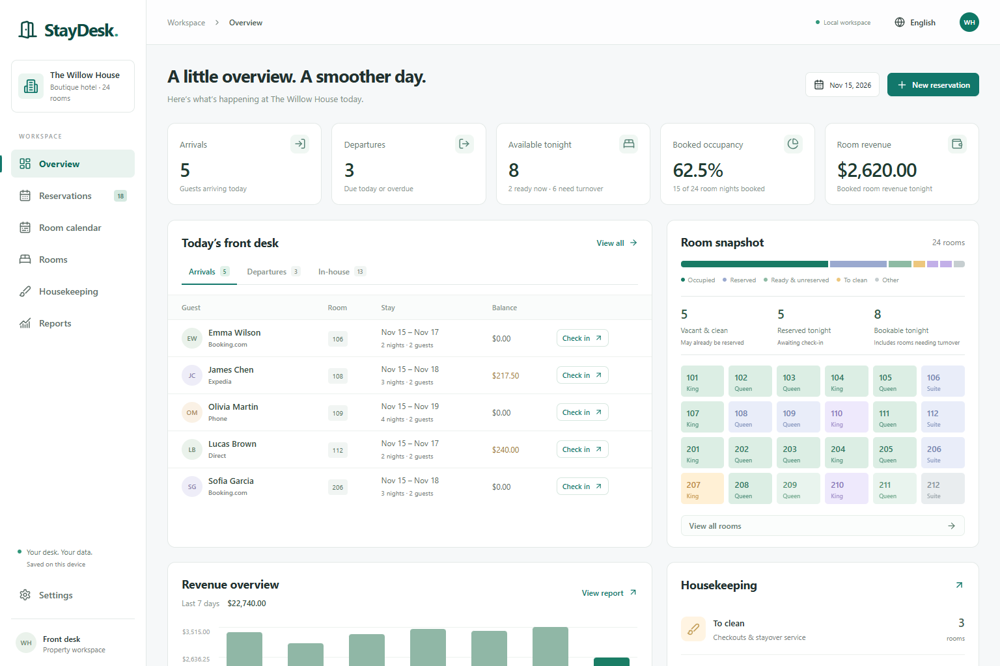
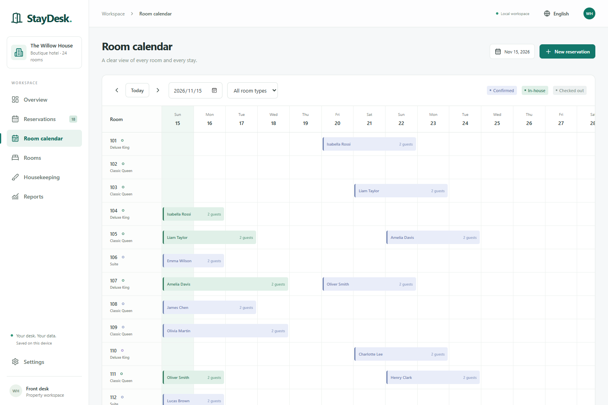
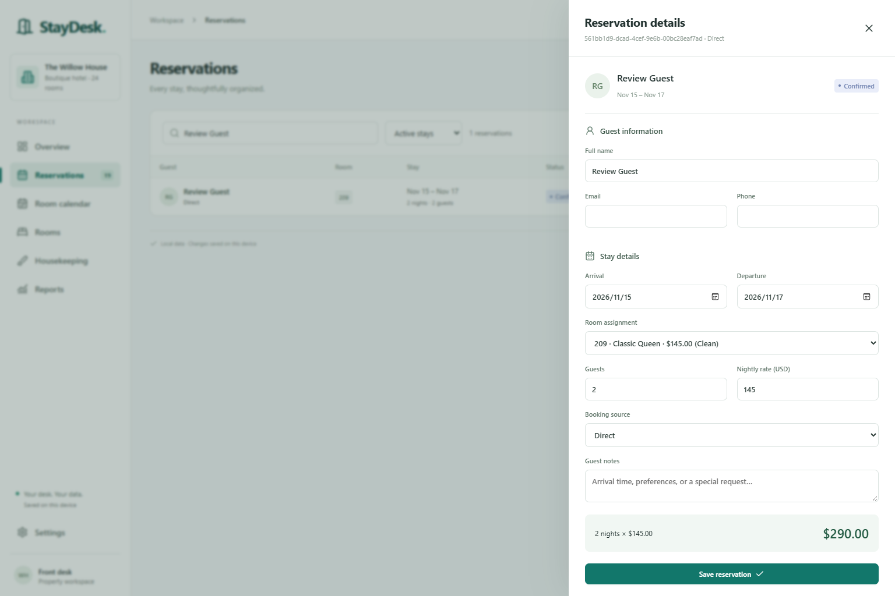
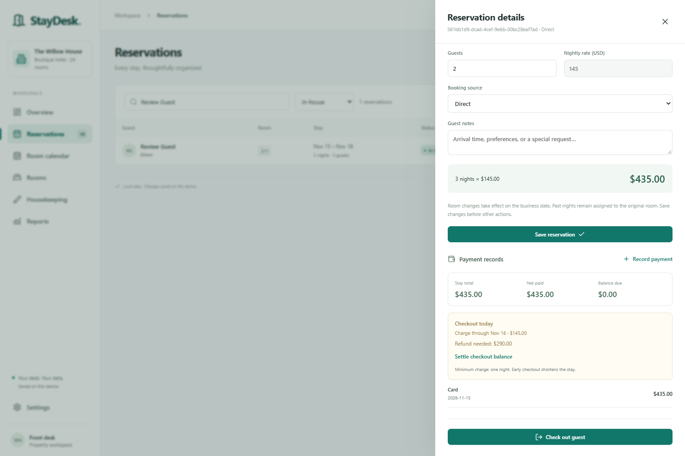
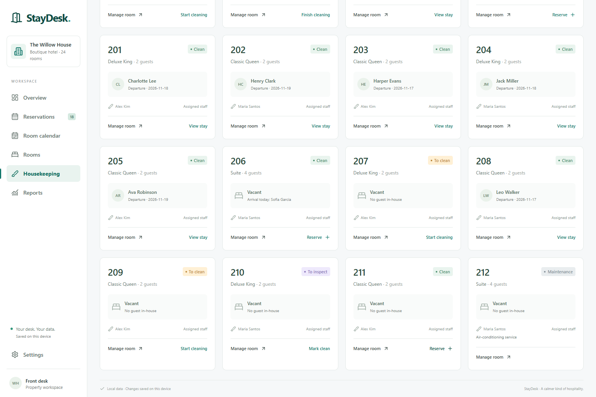
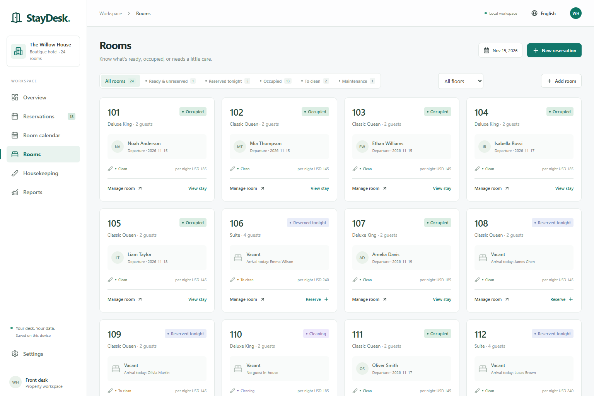
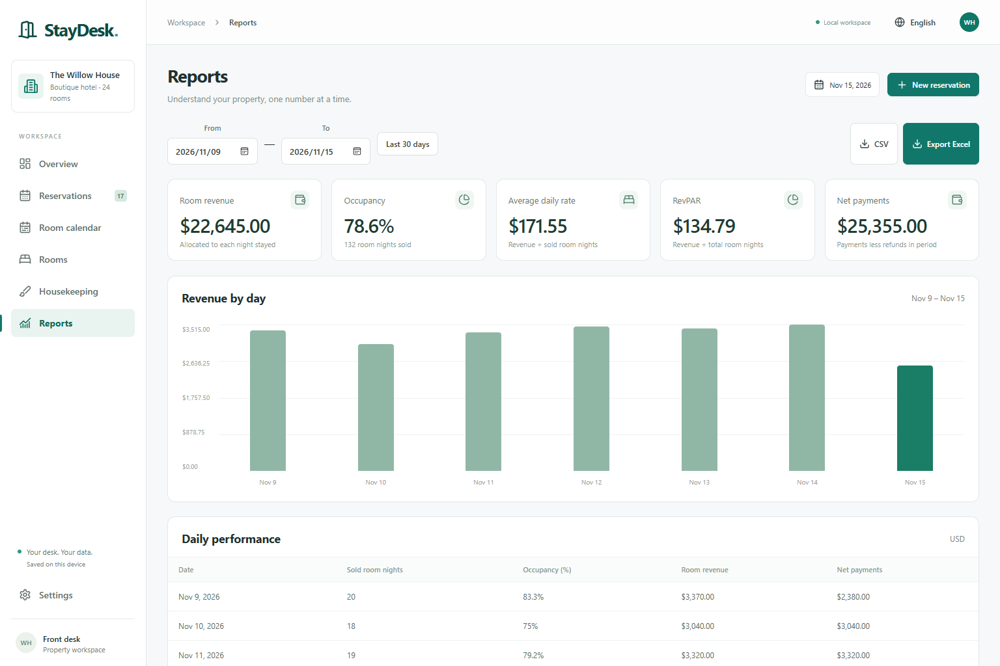
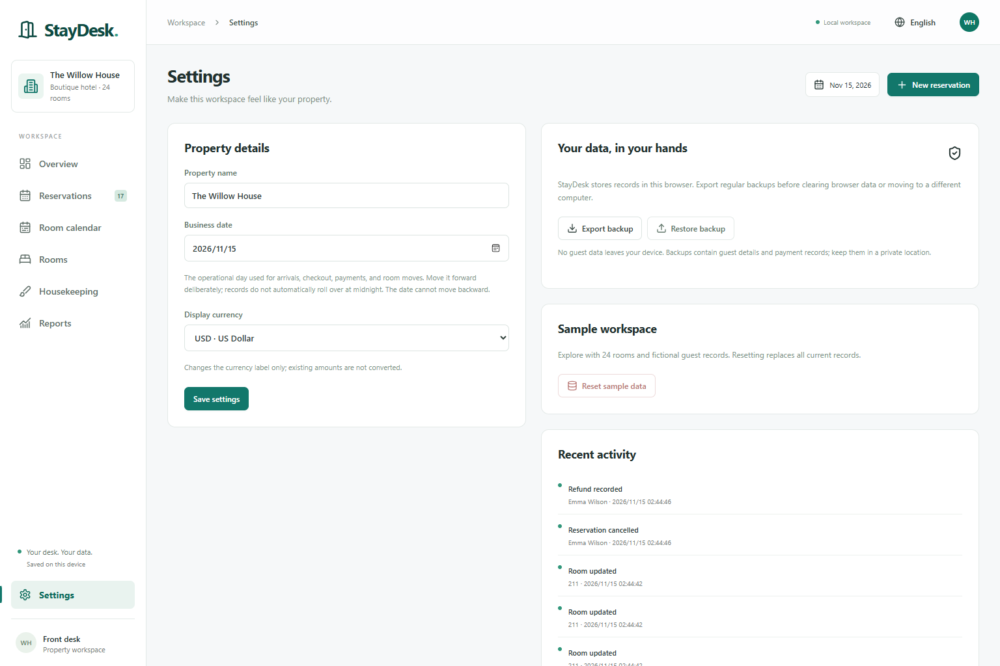
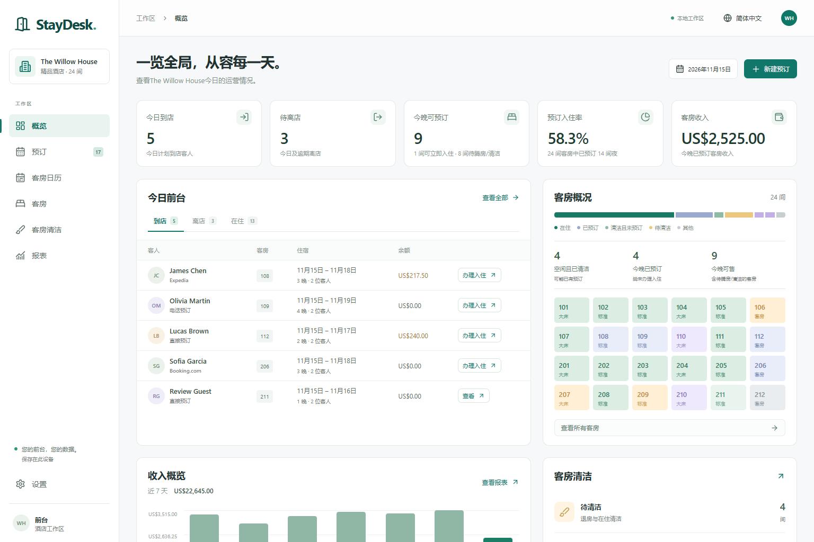
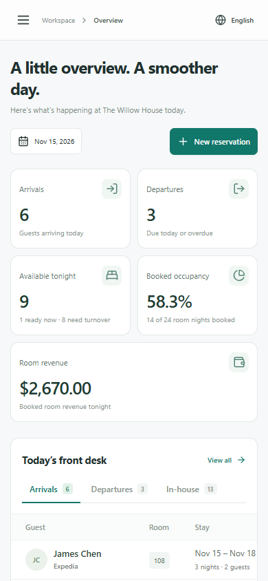

# StayDesk 1.1 — user guide

This guide covers the existing StayDesk workflow with the availability and reliability fixes in version 1.1. All screenshots below were captured from the working application using fictional data. They are not design mockups. The example business date is November 15, 2026; your first launch uses your computer's local date.

## 1. Open StayDesk on Windows

1. Right-click `StayDesk-v1.1-review.zip` and choose **Extract All**.
2. Move the extracted `StayDesk-v1.1` folder to a permanent location.
3. Double-click **StayDesk.html**. Choose Microsoft Edge or Google Chrome if asked.
4. Keep using that browser, profile, and file location for this workspace.

**Success:** the Overview page displays **The Willow House**, 24 rooms, and the five summary cards. No terminal, installation, local server, or network connection is needed for the offline app.

You can also use the private hosted application at [Open StayDesk](https://staydesk-willow-pms.humble-field-3507.chatgpt.site). Hosted and offline workspaces have separate browser storage. Transfer data using a backup if you move between them.

Before replacing an earlier offline version, open its Settings page and export a backup. Opening the new file at a different path may create a separate browser workspace. Restore your backup in the new version to continue with your records.

## 2. Read the dashboard correctly

The **Available tonight** card measures rooms that can accept a new reservation for the business date's overnight stay. The **Room snapshot** separates that from physical room readiness:

| Measure | What it means | Sample value |
| --- | --- | ---: |
| Vacant & clean | No guest physically in-house; room is clean and in service. It may already have a booking. | 5 |
| Reserved tonight | A confirmed reservation covers tonight and has not checked in. It can require cleaning or turnover. | 5 |
| Bookable tonight / Available tonight | No conflicting room-night reservation, maintenance block, or overdue occupant blocking today. | 8 |
| Ready now | Bookable tonight **and** vacant, clean, and in service. | 2 |
| Need turnover | Bookable tonight but still awaiting checkout, cleaning, or inspection. | 6 |

These measures overlap; do not add “vacant & clean” to “reserved tonight.” In the sample, three clean, vacant rooms already belong to arriving guests. Tonight has 15 booked room nights, 8 bookable rooms, and 1 maintenance room: **15 + 8 + 1 = 24**.

**Booked occupancy** measures calendar room nights, not the number of guests physically in the building right now. A guest due to leave today can still be in-house while their room is bookable for tonight. An overdue guest must be resolved first.

The Arrivals, Departures, and In-house tabs open the same underlying reservation records. Switching main sections starts the new page at the top; returning to a section does not leave it at the previous page's scroll position.

## 3. Use the room calendar

1. Open **Room calendar / 客房日历**.
2. Use the arrow buttons or date picker to select the first visible day. **Today / 今天** returns to the business date.
3. Optionally select a room type.
4. Click an empty current or future date cell to start a reservation for that room.
5. Click an existing stay to edit it.

**Success:** a new or updated reservation appears on the correct room row for its dates. Its departure date is not an occupied night. Dates with reservations, maintenance, or an overdue occupant cannot accept a conflicting booking. Past cells are not booking entry points. An amber **Overdue / 逾期未退** marker links to a guest who should already have departed.

For same-day turnover, a room due to depart today can be reserved for tonight. Check-in will remain blocked until the previous guest checks out and housekeeping makes the room clean. Current maintenance blocks begin at the business date; historical calendar bookings remain visible.

## 4. Create and find a reservation

1. Click **New reservation / 新建预订**, or choose an empty calendar cell.
2. Enter **Full name / 姓名**. Email and phone are optional.
3. Select arrival, departure, room, guest count, nightly rate, booking source, and any notes.
4. Click **Create reservation / 创建预订**.
5. Open **Reservations / 预订** to search by guest, email, reservation ID, or room number. Use the status filter to include cancelled or completed stays.

**Success:** the reservation has status **Confirmed / 已确认**, appears in the list and calendar, and immediately reduces booking availability for the selected nights.

If a room already has a booking, change the room or dates. A rejected save leaves the previous reservation and room data intact. Booking a dirty room is allowed for later arrival; checking into it is not. Guest count must fit the selected room.

## 5. Check in, change rooms, or extend a stay

1. Open a confirmed reservation whose arrival date is the current business date.
2. Confirm that the room is vacant, clean, and in service.
3. Click **Check in guest / 办理入住**.

**Success:** the reservation becomes **In-house / 在住**, the room becomes occupied, and the dashboard, Rooms page, and calendar reflect the change.

To change rooms, open the in-house reservation, choose a clean and vacant destination that is free for the remaining stay, and click **Save reservation / 保存预订**. Past nights remain assigned to the original room; the old room becomes dirty. A move on the arrival date has no past nights to retain. For an overdue stay, extend its departure first.

To extend or shorten the stay, change **Departure / 离店日期** and save. The new dates are checked for conflicts and the balance is recalculated. Arrival date and nightly rate are locked after check-in. Save edits before recording payments or checking out.

## 6. Record payments and check out

**Record payment / 记录付款** records a transaction you already completed outside StayDesk. It does not charge cards. Never enter a card number.

1. Open the reservation and click **Record payment**.
2. Choose **Payment received / 收到付款** or **Refund issued / 已退付款**.
3. Enter a positive amount, payment method, and optional reference.
4. Click **Save payment record / 保存付款记录**.

**Success:** the ledger, net paid, balance, and payment report update. The payment form initially suggests the outstanding amount for the **full stay**.

For checkout:

1. Review the separate **Checkout today / 今日退房预估** panel.
2. If leaving early or late, use **Settle checkout balance / 结清今日退房差额** to prefill the payment or refund needed for checkout today.
3. Complete that transaction outside StayDesk, then save its record.
4. Click **Check out guest / 办理离店** and confirm.

**Success:** the guest becomes **Checked out / 已离店** and the room becomes **To clean / 待清洁**. Checkout requires a zero adjusted balance. Early checkout shortens the billable stay with a minimum charge of one night. If arrival and checkout happen on the same day, the charge remains in revenue but the room is released for a new booking; it must still be cleaned before check-in.

In the screenshot, a three-night stay costs $435. Leaving on the arrival day reduces the charge to $145, so a $290 refund is needed. The full-stay balance and checkout estimate intentionally show different amounts until checkout completes.

## 7. Cancel a reservation

1. Find the reservation using the Confirmed filter.
2. Open it and click **Cancel reservation / 取消预订**.
3. Confirm cancellation.
4. If money was collected, reopen it using the Cancelled filter and record the refund after issuing it.

**Success:** the cancelled stay releases its room dates and contributes no room revenue. Payments stay in the ledger until refunded. The refund amount cannot exceed net money received. An in-house guest must use checkout instead of cancellation.

## 8. Complete housekeeping and manage rooms

1. Open **Housekeeping / 客房清洁**.
2. Filter by cleaning status if needed.
3. Click **Start cleaning / 开始清洁** when work begins.
4. Click **Finish cleaning / 完成清洁** when it is ready to inspect.
5. Click **Mark clean / 确认清洁** after inspection.

**Success:** the cleaning status becomes Clean. A room reserved for tonight remains reserved; cleaning does not make it available for another booking. The “ready now” count increases only for unreserved, vacant, in-service rooms.

Use **Manage room / 管理客房** to assign a housekeeper, add notes, or change the cleaning state directly.

On **Rooms / 客房**, a room's main badge describes occupancy or tonight's reservation. The separate cleaning badge describes housekeeping. “Reserved tonight” and “Clean” can both be true.

Use **Add room / 添加客房** to add a room, up to 80 total. Choose a unique room number, room type, capacity, and default rate. Default rate changes apply only to new bookings. A newly added room enters report capacity from its creation business date, so earlier occupancy reports do not change.

To mark a room out of service, first check out or move any current guest and move/cancel future reservations. Then enable **Out of service for maintenance / 因维修暂停使用** and save. Clear that checkbox when service is restored, and confirm the cleaning state before check-in.

## 9. Read reports and export Excel or CSV

1. Open **Reports / 报表**.
2. Select the From and To dates, up to 366 days inclusive.
3. Review the chart, totals, and daily rows.
4. Click **Export Excel / 导出 Excel** for a native `.xlsx` workbook, or **CSV** for a UTF-8 CSV file.
5. Open the downloaded file in Excel, WPS, or another spreadsheet application.

**Success:** the file contains one row per day with the same occupancy, revenue, and net payment values shown in StayDesk. Headers follow the selected UI language. Chinese CSV files include a UTF-8 marker for spreadsheet compatibility.

| Metric | Meaning |
| --- | --- |
| Room revenue | Nightly accommodation charges, including confirmed and in-house stays; future dates are forecasts. Cancelled stays are excluded. Same-day checkout retains its minimum charge. |
| Booked room nights | Distinct physical rooms booked overnight on each date, matching the calendar. A same-day completed stay does not hold an overnight room. |
| Occupancy | Booked room nights divided by physical room capacity for the dates. Maintenance rooms remain in capacity. |
| Average daily rate | Room revenue divided by sold room nights; shown as zero when none were sold. A minimum day-use charge can contribute revenue without an occupied night. |
| RevPAR | Room revenue divided by physical room capacity for the dates. |
| Net payments | Payments received minus refunds, grouped by the business date the transaction was recorded. |

Rates exclude taxes, extras, and commissions. Payment timing can differ from the dates on which room revenue is earned. Overdue nights enter accommodation charges when the departure is extended or checkout is completed.

## 10. Save, restore, and advance the business date

StayDesk saves changes in this browser. It does not synchronize guest records between devices, profiles, or the hosted/offline versions.

**Make a backup:** Settings → **Export backup / 导出备份**. Save the JSON file in a private folder. It contains guest and payment information.

**Restore a backup:** Settings → **Restore backup / 恢复备份** → select a StayDesk JSON file → confirm replacement. Export the current workspace first. Invalid or conflicting data is rejected before replacement.

**Success:** the restored property, rooms, reservations, and payments appear, and remain after reloading the page.

**Advance the day:** in Settings, change **Business date / 营业日期** and save. It controls arrivals, checkout, room moves, and payment dates. The date does not automatically roll over at midnight and cannot move backward. Restore an earlier backup if you need an earlier test workspace.

The currency setting changes display labels only; it does not convert existing amounts. **Reset sample data / 重置示例数据** replaces current records after confirmation. Use it only after exporting anything you want to retain.

Changes in another tab close an open drawer so stale edits cannot overwrite a newer record. Reopen the record before editing again. Prefer one active editing tab. If storage fails, the app displays an error rather than claiming a successful save; preserve a backup before troubleshooting.

## 11. Switch language and use a small screen

Click **English** to switch to Chinese, or **简体中文** to return to English. Navigation, forms, validation messages, dates, and report headers follow the selected language. Guest names, property names, staff names, and manually entered notes remain as entered. The language choice survives reloads.

On a narrow screen, use the menu button in the top-left corner to open navigation. Tables and the calendar can scroll horizontally without widening the whole page. The same booking and room-management controls remain available.

## 12. Troubleshooting

| What you see | What to do | Success indicator |
| --- | --- | --- |
| A clean room is reserved | Open its reservation or choose another room; cleaning does not release a booking. | Booking dates remain protected. |
| Check-in is blocked | Verify arrival date, previous guest's checkout, cleaning state, and maintenance. | Check-in changes the guest to In-house. |
| A stay extension conflicts | Move the upcoming reservation or choose another available room/date. | The calendar contains no overlapping assignments. |
| Checkout needs settlement | Use the checkout estimate and record the required payment/refund. | Checkout succeeds and marks the room dirty. |
| Data seems missing after moving the HTML file | Open the original file/profile or restore its exported backup into the new workspace. | Original reservations reappear. |
| Browser storage warning | Avoid clearing data first. Preserve a backup; restore a known valid file or free browser storage. | A new edit saves without an error. |
| Source files appear beside the app | This review package intentionally includes source, tests, docs, and screenshots. Open `StayDesk.html` to use the app. | The dashboard opens, with no development setup. |

This release is intended for a local, single-workstation workflow and final product review. It does not include staff accounts, multi-device synchronization, OTA integration, or actual card processing. Keep regular backups before using it for operational records.
